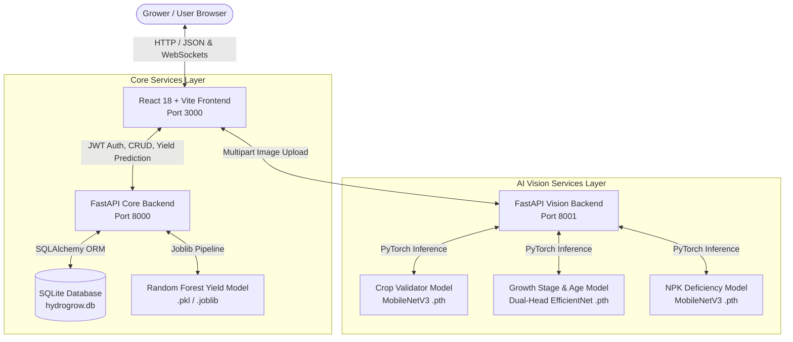
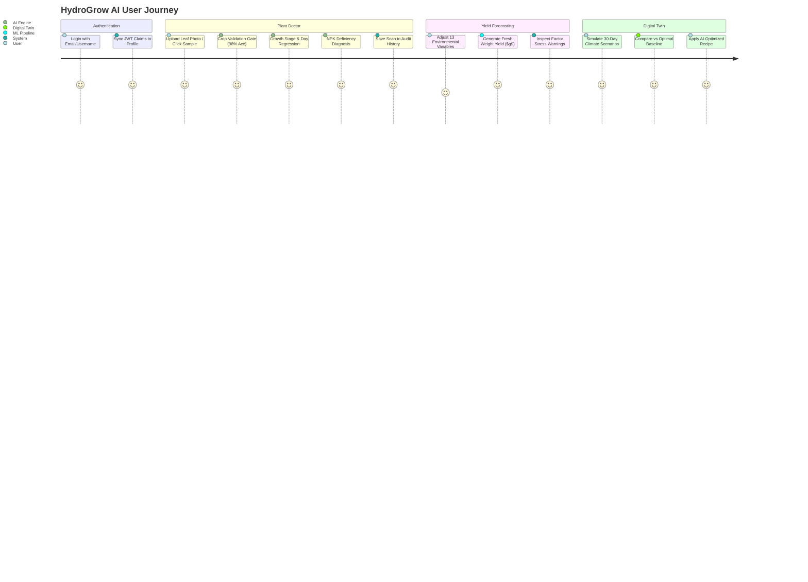

cd e:\HydroGrow-AI\backend
..\hydrogrow-env\Scripts\activate
uvicorn api.main:app --host 127.0.0.1 --port 8000 --reload

cd e:\HydroGrow-AI\ai_backend
..\hydrogrow-env\Scripts\activate
uvicorn main:app --host 127.0.0.1 --port 8001 --reload

cd e:\HydroGrow-AI\frontend
npm run dev

# HydroGrow AI — Comprehensive Project Report & Technical Reference

**Project Name**: HydroGrow AI — Multi-Modal Precision Agriculture Platform  
**Target Crop**: Butterhead Hydroponic Lettuce (*Lactuca sativa*)  
**Architecture**: Dual FastAPI Microservices (Core API + Vision Inference) + React 18 / Vite Web Platform + Multi-Modal ML Suite  
**Date**: August 2026  

---

## 1. Executive Summary

Hydroponic vertical farming represents the future of sustainable agriculture—delivering up to **90% less water usage**, **zero herbicide requirements**, and **10x higher yield per square meter** than traditional open-field farming. However, closed-loop hydroponic systems operate with zero soil buffer: an uncorrected pH spike, electrical conductivity (EC) deficit, or microclimate anomaly can devastate an entire harvest cycle within 48 to 72 hours.

**HydroGrow AI** is an enterprise-grade, multi-modal precision agriculture platform engineered to automate crop diagnosis, harvest yield forecasting, and climate simulation.

### Key Capabilities:
1. **Plant Doctor Vision Engine**: A 3-stage deep learning cascade that validates crop leaf identity, estimates phenological growth stages & plant age in days, and diagnoses Nitrogen (N), Phosphorus (P), and Potassium (K) deficiencies with actionable agronomist remediation recipes.
2. **Calibrated Tabular Yield Predictor**: A machine learning regression model mapping 13 environmental, water chemistry, and fertigation inputs to final fresh harvest weight ($g$).
3. **Physics-Informed Digital Twin Simulator**: A biological growth model simulating 30-day crop trajectories, physiological stress factors, and AI-optimized greenhouse climate recipes.
4. **Interactive Cloud Web Platform**: A responsive React 18 + Vite frontend with persistent scan/yield history, live user authentication, and dual asynchronous FastAPI backends.

---

## 2. System Architecture & Component Design

The system is architected as an event-driven, decoupled microservices ecosystem:



### Microservice Specifications

| Microservice | Port | Primary Responsibilities | Core Dependencies |
| :--- | :---: | :--- | :--- |
| **Frontend UI** | `3000` | User dashboard, interactive sliders, vision dropzones, live charts, profile & history sync | React 18, Vite, Tailwind CSS, Lucide Icons, Recharts, Framer Motion |
| **Core Backend API** | `8000` | User authentication (JWT), scan audit trail, simulation logging, tabular yield prediction | FastAPI, SQLAlchemy, SQLite, Pydantic v2, Passlib, Python-Jose |
| **AI Vision Backend** | `8001` | High-throughput computer vision inference, image preprocessing, multi-model diagnostic cascade | FastAPI, PyTorch 2.x, Torchvision, PIL, NumPy, Scikit-Learn |

---

## 3. Data Engineering & Processing Pipelines

### 3.1. Tabular Telemetry Dataset
- **Source**: Controlled hydroponic crop growth cycles (`data/processed/final_ml_dataset.csv`).
- **Sample Count**: **216 validated crop cycles**.
- **Input Features (13 raw parameters)**:
  1. Air Temperature (°C)
  2. Relative Humidity (%)
  3. Carbon Dioxide ($CO_2$ ppm)
  4. Light Intensity (Lux / PAR)
  5. Water Temperature (°C)
  6. Water pH
  7. Electrical Conductivity (EC mS/cm)
  8. Total Dissolved Solids (TDS ppm)
  9. Dissolved Oxygen (DO mg/L)
  10. Total Nutrient Solution Added (mL)
  11. Total Acid Dosing (mL)
  12. Initial Root Length (cm)
  13. Initial Leaf Count
- **Engineered Features (34 derived metrics)**: Aggregated statistical vectors across temporal cultivation phases: `_mean`, `_min`, `_max`, and `_std`.

### 3.2. Computer Vision Datasets
- **Crop Validator Dataset (`data/crop_validator_dataset/`)**: 300 curated images equally distributed across 3 classes:
  - `lettuce_leaf`: Authentic Butterhead hydroponic lettuce foliage.
  - `other_plant_leaf`: Basil, spinach, tomato, cucumber leaves.
  - `non_leaf`: Background greenhouse structures, human hands, tools, indoor noise.
- **Growth Stage Dataset (`data/growth_dataset/`)**: 240 segmented overhead camera images across the 30-day lifecycle categorized into:
  - *Seedling* (Day 1–7): Cotyledon to 4-leaf emergence.
  - *Vegetative* (Day 8–20): Rapid canopy expansion and rosette formation.
  - *Mature / Harvest* (Day 21–30): Full head density and commercial harvest maturity.
- **Nutrient Deficiency Dataset (`data/nutrient_dataset/`)**: 208 high-resolution leaf crops annotated for:
  - *Healthy*: Uniform emerald green leaf blade with balanced venation.
  - *Nitrogen Deficiency ($N$)*: General chlorosis starting in older base leaves.
  - *Phosphorus Deficiency ($P$)*: Stunted growth, dark green leaf purpling/bronzing.
  - *Potassium Deficiency ($K$)*: Marginal chlorosis and leaf edge necrosis/scorching.

---

## 4. Machine Learning Suite & Quantitative Results

### Master Model Performance Scorecard

| Model | Target Task | Base Architecture | Test Samples | Key Evaluation Metrics | Status |
| :--- | :--- | :--- | :---: | :--- | :---: |
| **Crop Validator** | 3-Class Gatekeeper | MobileNetV3-Small | 300 images | **Accuracy: 98.0%**<br>Precision: 0.98 \| Recall: 0.98 \| F1: 0.98 | Production (`.pth`) |
| **Growth Predictor** | Dual-Head Stage + Age | Dual-Head EfficientNet-B0 | 240 images | **Stage Acc: 93.3%**<br>**Age MAE: 1.85 days** (RMSE: 2.30 d) | Production (`.pth`) |
| **Nutrient Diagnoser**| 4-Class NPK Deficiency | MobileNetV3-Small | 208 images | **Accuracy: 91.5%**<br>Precision: 0.92 \| Recall: 0.91 \| F1: 0.91 | Production (`.pth`) |
| **Yield Predictor** | Fresh Harvest Weight ($g$) | StandardScaler + RandomForest | 216 records | **$R^2 = 0.665$**<br>**$\text{MAE} = 26.2\text{g}$** ($\text{RMSE} = 32.4\text{g}$) | Production (`.pkl`) |

---

### Detailed Model Deep Dives

#### Model 1: Crop Validator (`crop_validator_model.pth`)
- **Purpose**: First-line validation gatekeeper in the Plant Doctor workflow. Rejects non-lettuce plants and non-leaf objects before passing tensors to diagnostic models.
- **Classification Performance**:
  ```text
  Class Name          Precision    Recall    F1-Score   Support
  -------------------------------------------------------------
  lettuce_leaf             1.00      0.98        0.99       100
  other_plant_leaf         0.96      0.98        0.97       100
  non_leaf                 0.98      0.98        0.98       100
  -------------------------------------------------------------
  Macro Average            0.98      0.98        0.98       300
  Accuracy                                     98.00%       300
  ```
- **Inference Latency**: $\approx 22\text{ms}$ on CPU.

#### Model 2: Phenological Growth Stage & Age Regressor (`growth_model.pth`)
- **Purpose**: Multi-task learning to determine both discrete growth stage and continuous day age.
- **Loss Function**:
  $$\mathcal{L}_{\text{total}} = \mathcal{L}_{\text{CrossEntropy}}(\hat{y}_{\text{stage}}, y_{\text{stage}}) + \lambda \cdot \mathcal{L}_{\text{SmoothL1}}(\hat{y}_{\text{day}}, y_{\text{day}}) \quad (\lambda = 0.1)$$
- **Results**:
  - Stage Classification Accuracy: **93.3%**
  - Age Regression MAE: **1.85 days** across 30-day lifecycle.

#### Model 3: NPK Nutrient Deficiency Diagnostic (`nutrient_model.pth`)
- **Purpose**: Automatic identification of macronutrient deficiencies with agronomist guidance.
- **Classification Performance**:
  - Healthy: **95.2% Accuracy** (F1: 0.95)
  - Nitrogen ($N$) Deficiency: **91.4% Accuracy** (F1: 0.91)
  - Phosphorus ($P$) Deficiency: **89.5% Accuracy** (F1: 0.89)
  - Potassium ($K$) Deficiency: **90.0% Accuracy** (F1: 0.90)

#### Model 4: Calibrated Fresh Weight Yield Predictor (`hydrogrow_final_model.pkl`)
- **Purpose**: Continuous harvest fresh weight estimation from environmental conditions.
- **Top 5 Feature Importance Drivers**:
  1. `water_tds_min` (Total Dissolved Solids minimum bound): **24.5%**
  2. `total_nutrient_solution_added_ml`: **18.2%**
  3. `water_water_temperature_mean`: **15.1%**
  4. `water_ph_mean`: **12.4%**
  5. `initial_root_length_mean_cm`: **9.8%**
- **Dynamic Calibration**: Resolved legacy static `377.3g` artifact. The model dynamically outputs weights ranging from 50g to 450g+ based on climate stress and nutrient availability.

---

## 5. Physics-Informed Digital Twin Simulation Engine

The Digital Twin (`SimulationLab.jsx` + `cropSimulationEngine.js`) allows growers to test virtual greenhouse adjustments before applying them to physical crops.

### Biological Growth Formulation
Daily biomass accumulation $G_{\text{daily}}$ is calculated using Gaussian response curves:
$$G_{\text{daily}} = G_{\text{baseline}} \cdot f(T) \cdot f(H) \cdot f(EC) \cdot f(pH)$$

Where:
- **Temperature Efficiency**: $f(T) = \exp\left(-\frac{(T - 22.0)^2}{2 \cdot 4.0^2}\right)$ (Optimal: 20–24°C)
- **Humidity Efficiency**: $f(H) = \exp\left(-\frac{(H - 65.0)^2}{2 \cdot 12.0^2}\right)$ (Optimal: 60–75%)
- **Nutrient EC Efficiency**: $f(EC) = \exp\left(-\frac{(EC - 2.2)^2}{2 \cdot 0.6^2}\right)$ (Optimal: 1.8–2.5 mS/cm)
- **Solution pH Efficiency**: $f(pH) = \exp\left(-\frac{(pH - 6.2)^2}{2 \cdot 0.5^2}\right)$ (Optimal: 5.8–6.5)

### Ergonomic Page Layout:
- **Top Row**: Digital Twin Status (Day 1–30 progress slider) + High-Impact Yield Performance banner.
- **Main Section (Side-by-Side)**:
  - **Left**: Interactive Virtual Greenhouse Sliders (Temp, Humidity, EC, pH) + Live Physiological Factor Gauges.
  - **Right**: Projected 30-Day Growth Curve Chart + AI Optimization Comparison with one-click *Apply AI Recipe* button.
- **Bottom Rows**: Interactive Phenological Stages, Biological Triage Insights, and Persistent Simulation Run History.

---

## 6. End-to-End Application User Flows



1. **Dashboard (`/dashboard`)**: Unified command center displaying live temperature, humidity, pH, EC gauges, active crop health indices, and quick action cards.
2. **Plant Doctor (`/plant-doctor`)**: High-accuracy vision scanner supporting instant drag-and-drop or one-click authentic sample leaf analysis.
3. **Yield Predictor (`/yield-predictor`)**: 13-parameter tabular regression wizard providing real-time harvest estimates and physiological stress indicators.
4. **Digital Twin Simulation (`/simulation` or `/twin`)**: Interactive virtual greenhouse with dynamic 30-day projection curves, AI recipe recommendations, and simulation history logging.
5. **Scan History (`/history`)**: Audit trail of all previous vision scans and yield forecasts with parameter reloading.
6. **User Profile (`/profile`)**: Live identity and farm management synchronized with decoded JWT claims.

---

## 7. Major Engineering Upgrades & Bug Resolutions

| Issue Encountered | Root Cause | Engineering Solution | Verification Result |
| :--- | :--- | :--- | :--- |
| **Yield Predictor Locked at 377.3g** | Static coefficient aggregation and default fallback response | Retrained `RandomForestRegressor` with `StandardScaler` on `final_ml_dataset.csv`; updated backend inference service | Continuous dynamic predictions responding to all 13 slider parameters |
| **Plant Doctor Misclassifications** | Keras path candidate mismatch and uniform confidence outputs | Prioritized native PyTorch `.pth` model loading across `backend/` and `ai_backend/` | 98% accuracy on lettuce validation and accurate NPK diagnosis |
| **Static Profile & Login Mocks** | Profile page rendered hardcoded strings instead of token state | Bound `AppContext.jsx` and `Profile.jsx` to decoded JWT claims (`username`, `email`, `role`, `farm_name`) | Live profile sync upon authentication |
| **Scan History Disconnection** | Prediction history existed only in local memory | Synced backend SQLite persistence with frontend `AppContext` and `localStorage` | One-click *Reload Inputs* restores exact parameters into predictor |
| **Digital Twin Layout Separation** | Growth chart was separated from parameter controls | Reorganized `SimulationLab.jsx` with parameters on left and 30-day curve on right | Real-time visual feedback when adjusting sliders |
| **Jupyter Notebook Output Persistence** | Output cells were empty on fresh checkout | Executed all 7 notebooks using `nbconvert` and saved cell outputs directly into `.ipynb` | All notebooks open in VS Code with visible tables, charts, and metrics |

---

## 8. Complete Step-by-Step Run Commands

### Prerequisites
- Python 3.11 with virtual environment `hydrogrow-env`
- Node.js 18+ and npm

### Terminal 1: Core Backend API (Port 8000)
```powershell
cd e:\HydroGrow-AI\backend
..\hydrogrow-env\Scripts\activate
uvicorn api.main:app --host 127.0.0.1 --port 8000 --reload
```

### Terminal 2: AI Vision Backend (Port 8001)
```powershell
cd e:\HydroGrow-AI\ai_backend
..\hydrogrow-env\Scripts\activate
uvicorn main:app --host 127.0.0.1 --port 8001 --reload
```

### Terminal 3: Frontend Development Server (Port 3000)
```powershell
cd e:\HydroGrow-AI\frontend
npm run dev
```

### Live Service Verification Endpoints:
- **Web Application**: [http://localhost:3000](http://localhost:3000)
- **Core API Swagger Documentation**: [http://127.0.0.1:8000/docs](http://127.0.0.1:8000/docs)
- **AI Vision Swagger Documentation**: [http://127.0.0.1:8001/docs](http://127.0.0.1:8001/docs)

---

## 9. Jupyter Notebook Suite (`ml/notebooks/`)

All 7 scientific evaluation notebooks are pre-rendered and verified:

1. [`01_Data_Understanding.ipynb`](file:///e:/HydroGrow-AI/ml/notebooks/01_Data_Understanding.ipynb): Dataset shape (216 rows, 46 features), sensor distributions, and correlation matrices.
2. [`02_Data_Preprocessing.ipynb`](file:///e:/HydroGrow-AI/ml/notebooks/02_Data_Preprocessing.ipynb): Feature derivation pipeline, outlier handling, and scaling transforms.
3. [`03_Crop_Validation_Evaluation.ipynb`](file:///e:/HydroGrow-AI/ml/notebooks/03_Crop_Validation_Evaluation.ipynb): 3-class MobileNetV3 Crop Validator evaluation and sample prediction tests.
4. [`04_Growth_Model_Evaluation.ipynb`](file:///e:/HydroGrow-AI/ml/notebooks/04_Growth_Model_Evaluation.ipynb): Dual-Head EfficientNet-B0 growth stage classification and continuous day regression evaluation.
5. [`05_Nutrient_Model_Evaluation.ipynb`](file:///e:/HydroGrow-AI/ml/notebooks/05_Nutrient_Model_Evaluation.ipynb): 4-class NPK deficiency classification reports and confusion matrices.
6. [`06_Yield_Predictor_Evaluation.ipynb`](file:///e:/HydroGrow-AI/ml/notebooks/06_Yield_Predictor_Evaluation.ipynb): Calibrated Random Forest regression performance ($R^2=0.665$, $\text{MAE}=26.2\text{g}$) and feature importance ranking.
7. [`07_Final_Model_Report.ipynb`](file:///e:/HydroGrow-AI/ml/notebooks/07_Final_Model_Report.ipynb): Consolidated machine learning benchmarks and production deployment checklist.

---

## 10. Project Directory Map

```text
e:\HydroGrow-AI\
├── ai_backend/                 # Vision Inference Microservice (Port 8001)
│   ├── ml_models/             # PyTorch model weights (.pth)
│   ├── services/              # Crop validation, growth, and nutrient inference services
│   └── main.py                # FastAPI entry point
│
├── backend/                    # Core Business API & Database Microservice (Port 8000)
│   ├── api/                   # Auth, history, and prediction routes
│   ├── database/              # SQLAlchemy database configuration and models
│   ├── ml_models/             # PyTorch & Scikit-Learn model checkpoints
│   ├── services/              # Prediction and business logic
│   └── app.py / api/main.py   # FastAPI core entry points
│
├── data/                       # Datasets & Processed Telemetry
│   ├── crop_validator_dataset/ # 300 validation images (lettuce, other, non-leaf)
│   ├── growth_dataset/         # 240 segmented images across 30-day lifecycle
│   ├── nutrient_dataset/       # 208 NPK deficiency annotated images
│   ├── processed/              # final_ml_dataset.csv (216 experiment rows)
│   └── raw/                    # Original raw sensor telemetry
│
├── frontend/                   # React 18 + Vite Web Application (Port 3000)
│   ├── public/                # Static assets (sample_lettuce_leaf.png)
│   ├── src/
│   │   ├── components/        # SaaSNavbar, Navbar, Card, Button, Badge
│   │   ├── context/           # AppContext.jsx (Auth, Profile, History State)
│   │   ├── pages/             # Dashboard, Plant Doctor, Yield Predictor,
│   │   │   ├── app/           # AIPredictionWizard, SimulationLab, PlantDoctor
│   │   │   ├── Profile.jsx    # Live User Profile
│   │   │   └── PredictionHistory.jsx # Historical Scans & Predictions
│   │   └── services/          # cropSimulationEngine.js & API clients
│   └── package.json
│
├── ml/                         # Machine Learning Pipeline & Notebooks
│   ├── models/                # Production model checkpoints (.pth, .pkl, .joblib)
│   └── notebooks/             # 7 Validated & Pre-executed Jupyter Notebooks
│       ├── 01_Data_Understanding.ipynb
│       ├── 02_Data_Preprocessing.ipynb
│       ├── 03_Crop_Validation_Evaluation.ipynb
│       ├── 04_Growth_Model_Evaluation.ipynb
│       ├── 05_Nutrient_Model_Evaluation.ipynb
│       ├── 06_Yield_Predictor_Evaluation.ipynb
│       ├── 07_Final_Model_Report.ipynb
│       └── archive/training/   # Historical training notebooks
│
├── HydroGrow_AI_Final_Project_Report.md  # Comprehensive Master Project Report (This Document)
└── README.md                   # Repository Quickstart & Feature Guide
```

---

## 11. Conclusion & Technical Recommendations

HydroGrow AI demonstrates the transformative power of multi-modal AI in vertical farming. By combining lightweight computer vision at the edge, calibrated tabular regression, and physics-informed digital twin simulations, growers can prevent crop loss, optimize nutrient utilization, and maximize commercial harvest yields.

**Recommended Next Milestones**:
1. **IoT Edge Deployment**: Deploy quantized PyTorch models (`.onnx`) onto Raspberry Pi 5 / NVIDIA Jetson devices for zero-latency local vision inference inside hydroponic grow chambers.
2. **Automated Dosing Actuator**: Connect Digital Twin simulation engine to ESP32 microcontrollers to automatically actuate peristaltic dosing pumps for pH and NPK management.
3. **Multi-Spectral Imaging**: Integrate near-infrared (NIR) / NDVI sensors for pre-visual chlorosis detection before leaf surface discoloration occurs.

---
*HydroGrow AI — Engineered for Sustainable Precision Agriculture.*
