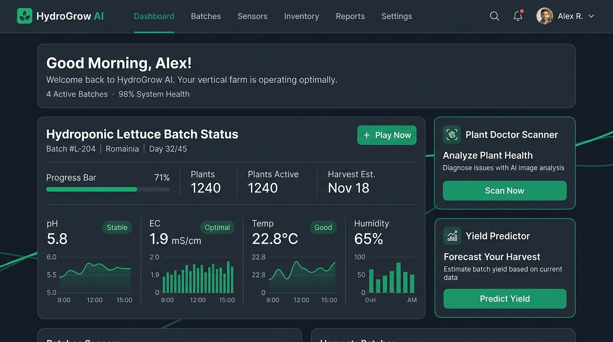
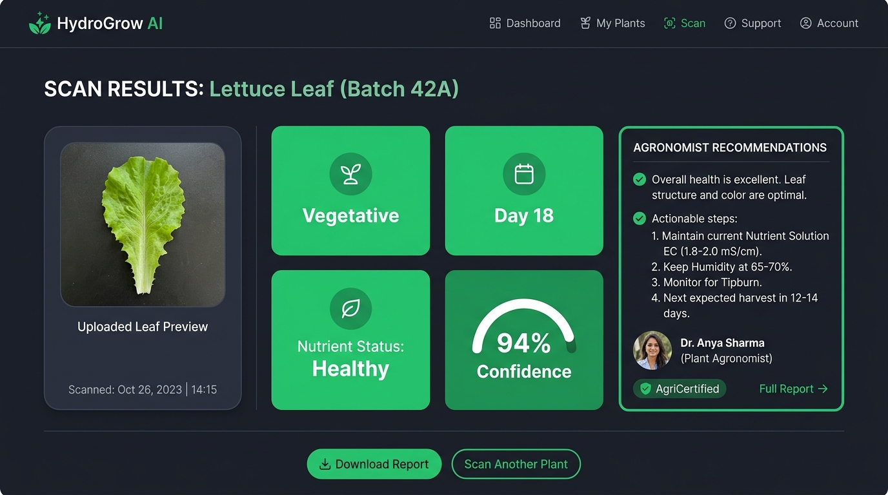
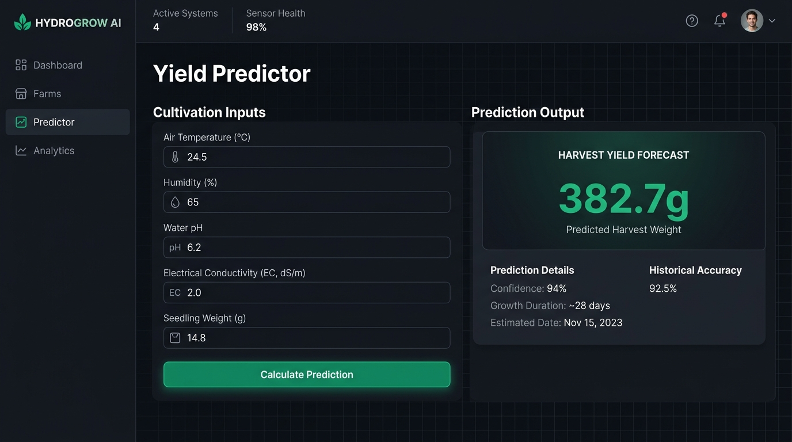
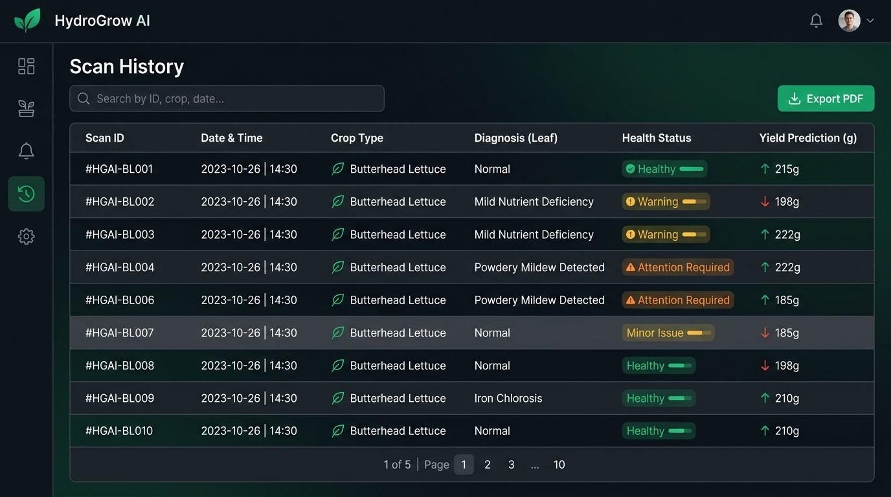

# HydroGrow AI — Multi-Modal Precision Agriculture Platform

[](https://reactjs.org/)
[](https://fastapi.tiangolo.com/)
[](https://pytorch.org/)
[](https://scikit-learn.org/)
[](https://tailwindcss.com/)

**HydroGrow AI** is an open-source, multi-modal precision agriculture platform designed for commercial hydroponic lettuce cultivation. It integrates deep learning computer vision, calibrated tabular yield regression, and a physics-informed digital twin simulation engine into a unified web application.

---

## 📸 Application Showcase

### 1. Executive Dashboard & Plant Doctor Scanner
| Executive Dashboard | Plant Doctor Vision Diagnosis |
| :---: | :---: |
|  |  |

### 2. Tabular Yield Predictor & Scan Audit Trail
| Fresh Weight Yield Predictor | Telemetry History & Audit Log |
| :---: | :---: |
|  |  |

---

## 🌟 Core Features

- **🌿 Plant Doctor Vision Scanner**:
  - **Crop Validation Gate**: Verifies leaf identity (98% accuracy) to filter non-lettuce and non-leaf objects.
  - **Growth Stage & Age Regressor**: Classifies stage (Seedling, Vegetative, Mature) and estimates exact age (1–30 days) with 1.85 days MAE.
  - **NPK Deficiency Diagnoser**: Identifies Healthy, Nitrogen (N), Phosphorus (P), and Potassium (K) deficiencies with actionable agronomist remediation advice.
- **📈 Calibrated Yield Predictor**:
  - Predicts final fresh harvest weight ($g$) from 13 continuous environmental, water chemistry, and fertigation parameters using a calibrated Random Forest regression pipeline ($R^2 = 0.665$, $\text{MAE} = 26.2\text{g}$).
- **🌐 Physics-Informed Digital Twin Simulator**:
  - Real-time side-by-side simulation laboratory comparing 30-day crop growth curves against optimal baselines.
  - Interactive virtual greenhouse sliders (Temperature, Humidity, EC, pH) and one-click *Apply AI Recipe* action.
- **📜 Persistent History & User Profile**:
  - Full audit logging of vision scans and yield predictions with instant parameter reloading and JWT-synced user profiles.

---

## 🔬 Production Machine Learning Suite

| Model | Target Task | Base Architecture | Dataset Count | Primary Performance Metric | Production File |
| :--- | :--- | :--- | :---: | :--- | :--- |
| **Crop Validator** | 3-Class Validation Gate | MobileNetV3-Small | 300 images | **Accuracy: 98.0%** (F1: 0.98) | `ml/models/crop_validator_model.pth` |
| **Growth Predictor** | 3 Stages + Age Day Regressor | Dual-Head EfficientNet-B0 | 240 images | **Stage Acc: 93.3%** \| **MAE: 1.85 days** | `ml/models/growth_model.pth` |
| **Nutrient Diagnoser**| 4-Class NPK Deficiency | MobileNetV3-Small | 208 images | **Accuracy: 91.5%** (F1: 0.91) | `ml/models/nutrient_model.pth` |
| **Yield Predictor** | Fresh Harvest Weight ($g$) | StandardScaler + RandomForest | 216 records | **$R^2 = 0.665$** \| **$\text{MAE} = 26.2\text{g}$** | `ml/models/hydrogrow_final_model.pkl` |

---

## 📓 Scientific Evaluation Notebooks

All 7 evaluation notebooks in [`ml/notebooks/`](ml/notebooks/) are pre-rendered with complete stdout metrics, tables, and confusion matrices:

- [`01_Data_Understanding.ipynb`](ml/notebooks/01_Data_Understanding.ipynb): Dataset exploration, sensor distributions & correlation analysis.
- [`02_Data_Preprocessing.ipynb`](ml/notebooks/02_Data_Preprocessing.ipynb): Data cleaning, outlier handling & feature scaling pipeline.
- [`03_Crop_Validation_Evaluation.ipynb`](ml/notebooks/03_Crop_Validation_Evaluation.ipynb): 3-class MobileNetV3 validation metrics and sample prediction tests.
- [`04_Growth_Model_Evaluation.ipynb`](ml/notebooks/04_Growth_Model_Evaluation.ipynb): Dual-Head EfficientNet-B0 stage classification and age day regression.
- [`05_Nutrient_Model_Evaluation.ipynb`](ml/notebooks/05_Nutrient_Model_Evaluation.ipynb): 4-class NPK deficiency classification and confusion matrices.
- [`06_Yield_Predictor_Evaluation.ipynb`](ml/notebooks/06_Yield_Predictor_Evaluation.ipynb): Calibrated Random Forest regression metrics and top feature importance.
- [`07_Final_Model_Report.ipynb`](ml/notebooks/07_Final_Model_Report.ipynb): Consolidated machine learning benchmarks and production scorecard.

---

## 🚀 Quickstart: Run Step-by-Step in VS Code

### Prerequisites
- Python 3.11 (`hydrogrow-env` virtual environment)
- Node.js 18+ and npm

### 1. Terminal 1: Core Backend API (Port 8000)
```powershell
cd e:\HydroGrow-AI\backend
..\hydrogrow-env\Scripts\activate
uvicorn api.main:app --host 127.0.0.1 --port 8000 --reload
```

### 2. Terminal 2: AI Vision Backend (Port 8001)
```powershell
cd e:\HydroGrow-AI\ai_backend
..\hydrogrow-env\Scripts\activate
uvicorn main:app --host 127.0.0.1 --port 8001 --reload
```

### 3. Terminal 3: Frontend Development Server (Port 3000)
```powershell
cd e:\HydroGrow-AI\frontend
npm run dev
```

### 4. Access in Your Browser
- **Frontend UI**: [http://localhost:3000](http://localhost:3000)
- **Core Backend Swagger API**: [http://127.0.0.1:8000/docs](http://127.0.0.1:8000/docs)
- **AI Vision Swagger API**: [http://127.0.0.1:8001/docs](http://127.0.0.1:8001/docs)

---

## 📁 Repository Structure

```text
HydroGrow-AI/
├── ai_backend/                 # Vision Inference Service (Port 8001)
│   ├── ml_models/             # PyTorch model weights (.pth)
│   ├── services/              # Crop validation, growth, and nutrient inference
│   └── main.py                # FastAPI entry point
│
├── backend/                    # Core Business & Auth API (Port 8000)
│   ├── api/                   # Auth, history, and prediction routes
│   ├── database/              # SQLAlchemy database configuration and models
│   ├── ml_models/             # PyTorch & Scikit-Learn model checkpoints
│   ├── services/              # Yield prediction and business logic
│   └── api/main.py            # FastAPI entry point
│
├── data/                       # Datasets & Processed Telemetry
│   ├── crop_validator_dataset/ # 300 validation images
│   ├── growth_dataset/         # 240 lifecycle images
│   ├── nutrient_dataset/       # 208 NPK deficiency images
│   ├── processed/              # final_ml_dataset.csv (216 experiment rows)
│   └── raw/                    # Raw telemetry data
│
├── frontend/                   # React 18 + Vite Web Application (Port 3000)
│   ├── public/                # Static assets (sample_lettuce_leaf.png)
│   ├── src/
│   │   ├── components/        # UI components (SaaSNavbar, Card, Button, Badge)
│   │   ├── context/           # AppContext.jsx (Auth, Profile, History State)
│   │   ├── pages/             # Dashboard, Plant Doctor, Yield Predictor,
│   │   │   ├── app/           # AIPredictionWizard, SimulationLab, PlantDoctor
│   │   │   ├── Profile.jsx    # Live User Profile
│   │   │   └── PredictionHistory.jsx # Historical Scans & Predictions
│   │   └── services/          # cropSimulationEngine.js & API clients
│   └── package.json
│
├── ml/                         # Machine Learning Pipeline & Notebooks
│   ├── models/                # Production model checkpoints (.pth, .pkl, .joblib)
│   └── notebooks/             # 7 Pre-executed Jupyter Evaluation Notebooks
│
├── HydroGrow_AI_Final_Project_Report.md  # Comprehensive Master Project Report
└── README.md                   # Repository Quickstart & Reference
```

---

## 📄 Documentation

For the exhaustive technical report containing mathematical derivations, architectural diagrams, deep ML benchmarks, and troubleshooting history, refer to:  
👉 [**`HydroGrow_AI_Final_Project_Report.md`**](HydroGrow_AI_Final_Project_Report.md)

---

## 👨‍💻 Author & Maintainer
Designed & Developed by **Karthikeya Cherukuri**  
*Built with Multi-Modal AI & Hydroponics Innovation.*
